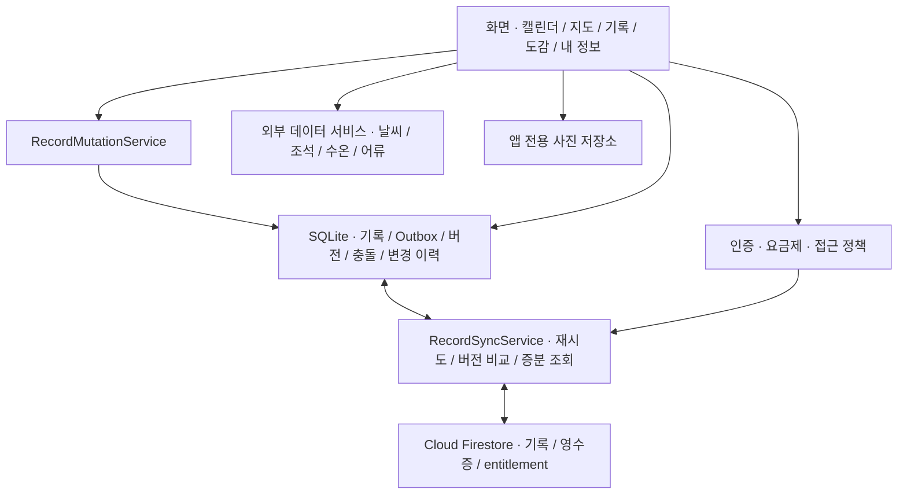

# Fishing Calendar · 낚시 캘린더

**장소와 날씨를 확인하고, 출조 기록을 남기고, 나의 기록어를 돌아보는 낚시 기록 앱입니다.**

현장에서 연결이 끊겨도 기록을 기기에 저장하고, 연결이 복구되면 계정과 요금제 정책에 따라 서버에 반영하도록 구현했습니다. 단순한 기록 CRUD에서 시작해 **오프라인 저장, 다중 기기 충돌, 계정별 데이터 격리, 조회 비용과 로컬 캐시**를 다루는 방향으로 발전시켰습니다.

[주요 기능](#주요-기능) · [설계와 문제 해결](#설계와-문제-해결) · [개발 기록](#개발-기록) · [실행 방법](#실행-방법) · [테스트와 현재 상태](#테스트와-현재-상태)

| 항목 | 내용 |
| --- | --- |
| 프로젝트 형태 | 개인 프로젝트 |
| 개발 범위 | 요구사항 정리, Flutter 앱, 로컬 DB, Firebase 연동, 테스트, 기술 문서 |
| 개발 기간 | 2026.01 프로젝트 시작 · 2026.05 Flutter 앱 개발 시작 · 개발 진행 중 |
| 주요 개발 대상 | Android |
| 현재 단계 | MVP 구현 후 출시 전 코드 감사 및 보완 단계 |

## 주요 기능

### 장소 확인부터 기록·공유까지

**장소 검색 → 날씨·조석·수온 확인 → 출조 기록 작성 → 캘린더 조회 → 기록어 확인·공유**의 흐름을 연결했습니다.

| 기능 | 구현 내용 |
| --- | --- |
| 출조 캘린더 | 날짜별 기록 조회, 여러 날짜에 걸친 출조의 연속 막대 표시 |
| 출조 기록 | 장소·기간·낚시 장르·날씨·조과·사진·메모 작성 및 수정·삭제, 검색·필터 |
| 지도·외부 정보 | 카카오 장소·주소 검색, 현재 위치, 수역 판별, 날씨·조석·수온과 과거 관측 정보 조회 |
| 어류도감 | 기본 800종 목록, 어종 검색·상세 조회, 공개 자료 기반 사진·설명 보완 |
| 내 기록어·공유 | 어종별 최고 크기와 무게의 독립 집계, 이름·크기·무게 정렬, 어종명 검색, 공유 카드 PNG 저장·기기 공유 |
| 계정·동기화 | 이메일 인증, 닉네임 중복 방지, 서버 요금제 확인, Outbox 전송·재시도, 다중 기기 충돌 해결 |
| 앱 정보 | 이용약관·개인정보 처리방침 열람, 버전·데이터 제공기관·라이선스 안내 |

지도에서 조회한 정보는 장소와 출조 시점이 맞을 때 기록에 자동 입력합니다. **물때·수온은 선택 입력**이며, 바다 전용 정보를 민물에 적용하지 않습니다. 도감의 800종 모두에 사진·상세 설명이 확보된 것은 아니며, 확인하지 못한 정보를 임의로 채우지 않습니다.

### 회원 상태별 저장 정책

| 상태 | 사용 범위 | 기록 저장·조회 |
| --- | --- | --- |
| 비회원 | 지도·어류도감 | 기록 관리 기능 접근 시 로그인 안내 |
| 무료 회원 | 출조 기록·캘린더·검색·기록어 | 기기의 SQLite에 원본 저장 |
| 유료 회원 | 무료 기능 + 서버 동기화·과거 기록 조회 | Firestore 원본 + 최근 31일 기기 캐시, 과거 기록은 필요할 때 조회 |

유료 권한은 서버의 entitlement 문서로 판정합니다. **실제 결제·구독 상품 연동은 후속 범위**이며, 무료로 전환하면 이미 내려받은 기록과 서버의 과거 원본을 보존합니다. 무료 기간에 수정·삭제한 내용은 재전환 시 동기화할 변경 이력으로 관리합니다.

사진은 선택 시 **앱 전용 디렉터리에 복사**합니다. Firebase Storage는 사용하지 않으며, 다른 기기에는 사진을 제외한 기록 본문이 동기화됩니다.

## 기술 스택

| 영역 | 사용 기술과 역할 |
| --- | --- |
| 앱 | Flutter, Dart, Material UI |
| 상태·화면 | StatefulWidget, ChangeNotifier, Navigator, IndexedStack |
| 로컬 저장 | sqflite, sqflite_common_ffi, SharedPreferences |
| 인증·서버 저장 | Firebase Authentication, Cloud Firestore, Security Rules, 복합 인덱스 |
| 네트워크·위치 | Dio, connectivity_plus, geolocator, kakao_map_plugin |
| 공공·공개 데이터 | 기상청, 국립해양조사원, 국립수산과학원, MBRIS, Wikimedia 등 |
| 사진·공유 | image_picker, path_provider, share_plus, gal, file_selector |
| 검증 | flutter_test, 메모리 SQLite 테스트, Firebase Auth·Firestore Emulator, Python unittest |

기준 개발 환경은 **Flutter 3.41.9 / Dart 3.11.5**입니다. iOS·데스크톱·웹 관련 설정도 포함되어 있지만, 플랫폼 전체의 배포 검증을 완료한 상태는 아닙니다.

## 구조



화면이 저장·전송 절차를 직접 처리하지 않도록 서비스와 저장소를 분리했습니다. 기록의 로컬 변경과 Outbox 작성은 트랜잭션으로 묶고, 서버 통신은 게이트웨이를 통해 호출하여 테스트에서 모의 구현으로 교체합니다.

<details>
<summary>폴더 구조 보기</summary>

```text
lib/
├── main.dart                  # 초기화와 복구, 서비스 시작
├── app.dart                   # 앱 구성과 생명주기 처리
├── core/                      # 테마, 입력 검증
├── data/
│   ├── auth/                  # Firebase 인증 게이트웨이
│   ├── local/                 # SQLite 스키마, 이전, 소유권 분리
│   ├── models/                # 기록, 버전, Outbox, 정책 모델
│   ├── repositories/          # 기록·세션·충돌 등의 저장소
│   ├── services/              # 변경, 동기화, 캐시, 사진 정리
│   ├── remote/                # Firestore 조회·쓰기 게이트웨이
│   └── ...                    # 지도, 기상·해양·어류 데이터, 공유
└── presentation/              # 화면과 UI 컴포넌트

test/                          # 단위·위젯·SQLite 통합 테스트
tool/                          # 규칙 검사, 데이터 수집·점검 도구
docs/                          # 설계 정책, API 설정, 검증·감사 기록
```

</details>

## 설계와 문제 해결

| 다룬 문제 | 적용한 방식 |
| --- | --- |
| 오프라인 저장·전송 재시도 | SQLite + Outbox, 서버 처리 영수증 |
| 다중 기기 수정 충돌 | 기준 버전 비교, 사용자 선택으로 충돌 해결 |
| 반복 전체 조회 | 증분 동기화, 최근 31일 캐시, 과거 기록 요청 시 조회 |
| 본문 캐시 정리와 사진 보존 | 기록 본문과 사진 참조의 수명 분리 |
| 외부 정보의 시공간 불일치 | 시간·좌표 검증, 캐시와 진행 중 요청 공유 |

<details>
<summary>문제 해결 과정과 관련 PR 자세히 보기</summary>

### 1. 오프라인 변경을 서버 전송과 분리

기록 저장 직후 네트워크 요청에만 의존하면 연결이 끊기거나 앱이 종료될 때 변경 사항을 복구하기 어렵습니다. SQLite에 기록과 전송 대기 항목인 **Outbox를 함께 저장**하고, 연결 복구 후 별도 동기화 서비스가 처리하도록 구성했습니다.

서버는 기록 변경과 처리 영수증을 하나의 Firestore 트랜잭션으로 기록합니다. 서버 반영 후 응답만 유실돼도 같은 요청 ID로 재시도할 수 있도록 했으며, 재시도 중 기존 요청의 본문을 바꾸지 않고 최신 변경을 후속 요청으로 남깁니다.

저장 후 화면 갱신 단계에서 실패해 이미 저장한 기록을 다시 생성하는 문제도 고려했습니다. 트랜잭션 안에서 후속 조회·디코딩을 확인하고, 커밋 후에는 준비한 결과를 메모리에 반영하도록 저장·실패 처리 경계를 보완했습니다.

- 관련 PR: [SQLite 저장 #23](https://github.com/yunjinhwa/fishing_calendar/pull/23), [Firestore 동기화 #26](https://github.com/yunjinhwa/fishing_calendar/pull/26), [요금제 이전 무결성 #33](https://github.com/yunjinhwa/fishing_calendar/pull/33), [저장 실패 복구 #35](https://github.com/yunjinhwa/fishing_calendar/pull/35)
- 설계 문서: [기록 동기화](docs/firestore_record_sync.md), [요금제 전환 중 기록 보존](docs/plan_migration_integrity.md), [저장 실패 처리](docs/record_save_recovery.md)

### 2. 계정 변경과 다중 기기 수정에 대응

동기화 중 계정이 바뀌거나 다른 기기에서 같은 기록을 수정하는 상황을 고려했습니다. 로컬 데이터는 Firebase UID 기준으로 분리하고, 비동기 작업에는 소유 계정과 세션 세대를 확인하는 검사를 적용했습니다.

기록 수정 요청에는 기준 버전을 포함합니다. 서버 버전과 다르면 자동으로 덮어쓰지 않고 충돌을 기기에 보관하며, 사용자가 **내 변경·서버 변경·필드별 병합**을 선택하도록 구현했습니다. 열린 편집 화면도 원본 변경을 감지하도록 보완했습니다.

- 관련 PR: [충돌 해결 #28](https://github.com/yunjinhwa/fishing_calendar/pull/28), [서버 요금제 권한 #29](https://github.com/yunjinhwa/fishing_calendar/pull/29), [편집 버전 보호 #34](https://github.com/yunjinhwa/fishing_calendar/pull/34)
- 설계 문서: [서버 entitlement](docs/server_plan_entitlement.md), [편집 중 변경 보호](docs/record_edit_version.md)

### 3. 반복 전체 조회를 줄이고 과거 이력을 필요할 때 조회

동기화마다 모든 기록을 읽고 다시 쓰는 흐름을 개선했습니다. 서버 갱신 시각과 문서 ID를 함께 사용하는 커서로 변경분을 페이지 조회하고, 실제로 바뀐 ID만 SQLite에 반영합니다. 값이 같으면 불필요한 DB 쓰기와 화면 변경 알림을 생략합니다.

유료 회원은 최근 31일 기록을 기본 캐시로 유지하고, 과거 월은 선택할 때 조회합니다. 검색과 기록어는 전체 이력이 필요하므로 별도 조회하며, 필터 입력·정렬 변경마다 서버를 다시 호출하지 않습니다. 최초·복구용 전체 조회도 유지합니다.

- 관련 PR: [증분 동기화 #38](https://github.com/yunjinhwa/fishing_calendar/pull/38), [31일 캐시 #39](https://github.com/yunjinhwa/fishing_calendar/pull/39)
- 설계 문서: [증분 동기화](docs/incremental_record_sync.md), [캐시 정책](docs/paid_cache_policy.md)

### 4. 기록 본문 캐시와 사진 파일의 수명을 분리

과거 기록 본문을 캐시에서 제외해도 같은 기기의 사진이 사라지지 않도록 독립 사진 참조를 보관합니다. 반대로 작성 취소·사진 제거·기록 삭제 후에는 다른 기록이나 작성 중 화면에서 참조하지 않는 앱 내부 파일을 정리합니다.

기록어의 최고 크기와 최고 무게는 각각 실제 조과를 근거로 집계합니다. 공유 카드도 선택한 조과와 출조 사진을 연결해 서로 다른 개체의 크기·무게를 하나의 실적으로 섞지 않도록 했습니다.

- 관련 PR: [사진 정리 #37](https://github.com/yunjinhwa/fishing_calendar/pull/37), [기록어 정확성 #47](https://github.com/yunjinhwa/fishing_calendar/pull/47), [공유 이미지 #48](https://github.com/yunjinhwa/fishing_calendar/pull/48)
- 설계 문서: [사진 정리](docs/local_photo_cleanup.md), [기록어 집계](docs/personal_best_accuracy.md), [이미지 공유](docs/share_record_image.md)

### 5. 외부 정보의 시간·위치·제공 범위를 검증

날씨 예보와 과거 관측 자료를 구분하고, 기록의 위치·시점과 일치하는 정보만 자동 입력합니다. 수역 판별을 거쳐 바다 전용 정보의 표시 범위를 정하며, 없는 값을 추정해 표시하지 않습니다.

반복 조회에는 유효 기간이 있는 캐시와 진행 중 요청 공유를 적용했습니다. 위치 변경 뒤 늦게 도착한 응답이 새 선택을 덮어쓰지 않도록 요청의 유효성을 확인합니다.

- 관련 PR: [카카오 지도 #41](https://github.com/yunjinhwa/fishing_calendar/pull/41), [날씨 #42](https://github.com/yunjinhwa/fishing_calendar/pull/42), [조석 #43](https://github.com/yunjinhwa/fishing_calendar/pull/43), [수온 #44](https://github.com/yunjinhwa/fishing_calendar/pull/44), [과거 관측 #45](https://github.com/yunjinhwa/fishing_calendar/pull/45)
- 설계 문서: [수역 판별](docs/water_area_detection.md), [과거 관측 조회](docs/historical_external_data.md)

위 내용은 현재 구현의 설계 방향입니다. 감사에서 추가로 확인한 인증 경합과 첫 동기화 재시도 문제 등은 아래의 [현재 보완 사항](#현재-보완-사항)에 공개하고 있습니다.

</details>

## 개발 기록

로컬 커밋과 병합된 PR을 기준으로 주요 전환점을 정리했습니다. 초기 화면 구현 이후 실제 저장·인증·동기화로 확장하고, 별도 수정·감사 브랜치에서 데이터 보존 문제와 검증 범위를 다뤘습니다.

| 단계 | 주요 변화 | 관련 PR |
| --- | --- | --- |
| 2026.05~06 · 초기 MVP | 탭·캘린더·기록·지도·도감·검색 흐름과 사진 첨부 구현 | [#1](https://github.com/yunjinhwa/fishing_calendar/pull/1), [#4](https://github.com/yunjinhwa/fishing_calendar/pull/4), [#18](https://github.com/yunjinhwa/fishing_calendar/pull/18) |
| 2026.09 · 저장·인증 연결 | SQLite, 연결 상태 감지, Firebase 인증·기록 동기화 도입 | [#23](https://github.com/yunjinhwa/fishing_calendar/pull/23)~[#26](https://github.com/yunjinhwa/fishing_calendar/pull/26) |
| 2026.10 · 데이터 무결성 | 다중 기기 충돌, 서버 요금제 권한, 탈퇴 정리, 이전·편집·저장 실패 처리 | [#28](https://github.com/yunjinhwa/fishing_calendar/pull/28)~[#35](https://github.com/yunjinhwa/fishing_calendar/pull/35) |
| 2026.10~11 · 조회·데이터 확장 | 증분 동기화, 캐시, 실제 지도·기상·해양 API, 어류도감 연동 | [#38](https://github.com/yunjinhwa/fishing_calendar/pull/38)~[#46](https://github.com/yunjinhwa/fishing_calendar/pull/46) |
| 2026.11 · MVP 검증 | 기록어·공유 이미지, 통합 점검, 정책·라이선스 문서화, 출시 전 코드 감사 | [#47](https://github.com/yunjinhwa/fishing_calendar/pull/47)~[#53](https://github.com/yunjinhwa/fishing_calendar/pull/53) |

전체 이력은 [커밋 목록](https://github.com/yunjinhwa/fishing_calendar/commits/develop)과 [병합된 PR](https://github.com/yunjinhwa/fishing_calendar/pulls?q=is%3Apr+is%3Amerged)에서 확인할 수 있습니다.

## 실행 방법

### 1. 기본 개발 모드

Flutter SDK를 설치하고 Android 에뮬레이터 또는 USB 디버깅 기기를 준비합니다. SQLite는 앱이 생성하므로 별도의 DB 서버 설치가 필요하지 않습니다.

```bash
git clone https://github.com/yunjinhwa/fishing_calendar.git
cd fishing_calendar
git switch develop
flutter pub get
flutter run
```

디버그 빌드에서 Firebase 인증은 기본 비활성화됩니다. 기본 실행은 로컬 개발 모드이며, 실제 계정 인증·서버 동기화에는 아래 Firebase 설정이 필요합니다. 지도·외부 API 설정이 없으면 해당 조회 기능은 제한됩니다. 기본 어류 목록은 번들 데이터를 사용합니다.

<details>
<summary>Firebase·지도·외부 API 설정 보기</summary>

### 2. Firebase 연결

저장소에는 개발 프로젝트의 Firebase 구성이 포함되어 있습니다. 다른 환경에서는 본인 Firebase 프로젝트로 연결하고 Email/Password 인증·Firestore·보안 규칙·인덱스를 설정합니다.

```bash
flutter run --dart-define=FIREBASE_AUTH_ENABLED=true
```

프로젝트 연결과 로컬 에뮬레이터 사용은 [Firebase 설정](docs/firebase_auth_setup.md), 동기화 규칙·인덱스는 [Firestore 설정](docs/firestore_record_sync.md)을 참고합니다. 릴리스 빌드는 Firebase 인증이 기본 활성화됩니다.

### 3. 지도·외부 데이터 설정

프로젝트 루트의 예제 JSON을 같은 이름의 `.local.json`으로 복사하고 사용할 서비스의 키를 입력합니다. 기존 로컬 설정 파일이 있다면 덮어쓰지 않습니다.

| 예제 → 로컬 파일 | 주요 설정 | 안내 |
| --- | --- | --- |
| `kakao.example.json` → `kakao.local.json` | JavaScript 키·등록 도메인 | [카카오 지도](docs/kakao_map_setup.md) |
| `weather.example.json` → `weather.local.json` | 기상청 인증키·제공처 | [날씨](docs/weather_api_setup.md), [과거 관측](docs/historical_external_data.md) |
| `tide.example.json` → `tide.local.json` | 해양조사원 인증키 | [조석](docs/tide_api_setup.md), [수온](docs/water_temperature_api_setup.md) |
| `fish.example.json` → `fish.local.json` | 선택한 어류 데이터 제공처 인증키 | [어류도감](docs/fish_encyclopedia_api.md) |

설정한 파일을 실행 옵션으로 전달합니다. 아래 명령은 네 로컬 파일을 모두 준비한 경우의 예시입니다.

```bash
flutter run --dart-define=FIREBASE_AUTH_ENABLED=true --dart-define-from-file=kakao.local.json --dart-define-from-file=weather.local.json --dart-define-from-file=tide.local.json --dart-define-from-file=fish.local.json
```

각 API의 활용 승인은 별도로 필요합니다. NARIS 키는 필수가 아니며, 설정 파일 변경 후에는 앱을 종료하고 다시 실행합니다. 로컬 인증키 파일은 `.gitignore`로 제외하고 실제 키를 README나 예제 파일에 넣지 않습니다.

</details>

## 테스트와 현재 상태

### MVP 실행 확인

실제 기기에서 확인할 핵심 흐름만 정리했습니다. 상세 절차는 [MVP 테스트 체크리스트](docs/mvp_test_checklist.md)를 참고합니다.

| 시나리오 | 확인할 내용 |
| --- | --- |
| 계정·접근 | 비회원은 지도·도감 이용, 회원은 기록 관리 |
| 기록·캘린더 | 작성·수정·삭제가 날짜별 목록과 캘린더에 반영 |
| 지도·외부 정보 | 장소 검색 → 정보 조회 → 기록 작성으로 연결 |
| 검색·기록어·공유 | 조건별 검색, 어종별 최고 기록, 이미지 저장·공유 |
| 오프라인 | 기기 저장 유지, 연결 복구 후 유료 계정의 대기열 전송 |
| 두 기기 | 같은 계정의 기록 조회, 동시 수정 시 충돌 해결 |

### 자동 검증

<details>
<summary>테스트 실행 명령 보기</summary>

저장소·서비스의 단위 테스트, 화면 위젯 테스트, 메모리 SQLite를 사용하는 저장·이전 테스트, 로컬 Firebase 규칙 검사를 함께 사용합니다.

```bash
flutter analyze --no-pub
flutter test --no-pub
python -m unittest tool.test_collect_nifs_fish_photos -v
```

Firebase CLI와 Java 환경이 준비되어 있으면 별도 터미널에서 앱을 연결하지 않은 상태로 로컬 규칙 검사를 실행할 수 있습니다.

```bash
firebase emulators:exec --only auth,firestore --project demo-fishing-readme "node tool/firestore_rules_smoke.mjs"
```

</details>

**아래는 2026-11-09 코드 감사 기준(`7929bf8`)의 결과입니다.** README 변경으로 테스트를 다시 실행한 결과나 배포 검증을 뜻하지 않습니다.

| 검증 | 결과 |
| --- | --- |
| Flutter 정적 분석 | 문제 없음 |
| Flutter 단위·위젯·저장 테스트 | 1,279개 중 1,276개 통과·3개 실패 |
| Python 파서 테스트 | 4개 통과 |
| 기존 Auth·Firestore 규칙 검사 | 로컬 에뮬레이터 통과 |
| 추가 진단 | 인증 경합, 이전 충돌 후 재동기화 실패, 서버 스키마 불일치, 초기 DB 오류 처리 경로 확인 |

실패한 기존 테스트 3개는 앱 정보 화면 문구·출처 목록과 기대값이 어긋난 항목입니다. 추가 진단에서 확인한 결함은 별도 수정 대상이며, 기존 규칙 검사 통과만으로 모든 서버 데이터 검증이 완료됐다고 판단하지 않습니다.

### 현재 보완 사항

| 구분 | 남은 작업 |
| --- | --- |
| 우선 수정 | 인증 작업 경합, 첫 이전 충돌 후 재동기화 중단 |
| 안정성 | 서버 스키마·DB 복구·사진 디코딩·지도 갱신·실패 테스트 |
| 사용성 | 화면 정리, 월 선택·스와이프, 상단 알림, 오늘의 요약, 프로필 |
| 출시 준비 | 운영 약관·서명·스토어 설정, 결제 범위, 비밀번호 재설정 연결 |

발생 조건과 수정 우선순위는 [코드 감사 보고서](docs/pre-release-audit.md)에 정리했습니다.

## 문서 안내

<details>
<summary>주제별 설계·설정·검증 문서 보기</summary>

| 주제 | 문서 |
| --- | --- |
| 요구사항·통합 검증 | [MVP 통합 점검](docs/mvp_integration_check.md), [실제 기기 체크리스트](docs/mvp_test_checklist.md) |
| 저장·복구 | [저장 실패·작성 취소](docs/record_save_recovery.md), [계정 탈퇴](docs/account_deletion.md), [좌표 저장](docs/location_coordinates.md) |
| 데이터 정책 | [선택 입력](docs/optional_record_conditions.md), [캐시](docs/paid_cache_policy.md), [요금제 이전](docs/plan_migration_integrity.md) |
| 어류 데이터 | [연동 방식](docs/fish_encyclopedia_api.md), [정보 제공 범위](docs/fish_data_coverage.md) |
| 약관·출처 | [약관 초안](docs/terms_and_privacy.md), [앱 정보·라이선스](docs/app_info_and_licenses.md) |
| 감사·후속 계획 | [감사 결과](docs/pre-release-audit.md), [검토 범위](docs/pre-release-audit-coverage.md), [추가 요구사항](docs/pre-release-additional-requirements.md) |

</details>

외부 데이터·사진·변환 코드의 이용조건은 각 자료의 고지를 따릅니다. 앱에서도 제공기관·제작자·라이선스를 안내하며, 저장소의 추가 고지는 [`third_party/`](third_party/)에서 확인할 수 있습니다.
